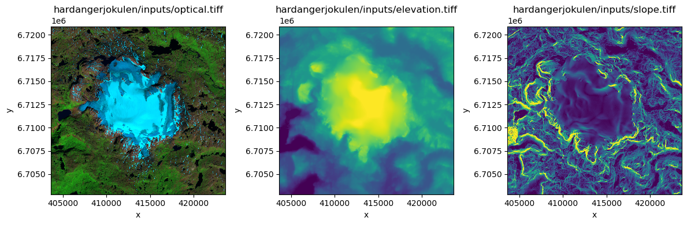

<p align="center">
  
</p>

<h1 align="center">🏔️ Automated Feature Detection & Change Analysis</h1>
<h3 align="center">GlacioWatch — Real-time Himalayan Glacier Monitoring using Satellite Imagery & Deep Learning</h3>

<p align="center">
  
  
  
  
  
  
</p>

---

## 📋 Table of Contents

- [Overview](#-overview)
- [The Crisis](#-the-crisis--why-it-matters)
- [System Architecture](#-system-architecture)
- [Technical Achievements](#-technical-achievements)
- [Project Structure](#-project-structure)
- [Getting Started](#-getting-started)
- [ML Pipeline](#-ml-pipeline)
- [Web Dashboard](#-web-dashboard)
- [API Reference](#-api-reference)
- [Future Roadmap](#-future-roadmap)
- [License](#-license)

---

## 🌟 Overview

**GlacioWatch** is an autonomous, end-to-end platform designed to monitor the health and retreat of Himalayan glaciers in real-time. By bridging **remote sensing**, **deep learning (U-Net)**, and **modern web engineering**, it translates raw Sentinel-2 satellite imagery into actionable climate insights and early warning signals for **Glacial Lake Outburst Floods (GLOFs)**.

### Key Capabilities

- 🛰️ **Automated Satellite Data Ingestion** — Sentinel-2 multispectral & EnMAP hyperspectral imagery
- 🧠 **U-Net Semantic Segmentation** — Pixel-level glacier boundary detection (97.74% accuracy)
- 📊 **Change Detection Engine** — Calculates annual retreat rates and risk classification
- 🌐 **Real-time Dashboard** — Interactive map with live glacier status for 29+ Himalayan glaciers
- 🔔 **Early Warning System** — Automated alerts for rapid retreat and GLOF risk
- 🤖 **LLM-powered Reports** — Llama 3.2 synthesizes raw metrics into scientific summaries

---

## 🚨 The Crisis — Why It Matters

| Metric | Impact |
|:---|:---|
| **Glacier Retreat** | Himalayan glacier area decreased by >30% in 40 years |
| **Water Security** | Threatens supply for 700+ million people |
| **Energy** | India's hydroelectric output dropped 16.3% in FY 23-24 |
| **Safety** | 2023 Sikkim GLOF — catastrophic flash flood, 40+ lives lost |

---

## 🏗️ System Architecture

```
┌─────────────────────────────────────────────────────────────────────┐
│                     GlacioWatch Architecture                        │
├──────────────┬──────────────┬──────────────────┬────────────────────┤
│  Data Layer  │   ML Layer   │   Backend API    │    Frontend        │
├──────────────┼──────────────┼──────────────────┼────────────────────┤
│ Sentinel-2   │ U-Net        │ FastAPI          │ Next.js 15         │
│ EnMAP        │ Segmentation │ REST endpoints   │ React-Leaflet Map  │
│ GLIMS/RGI    │ Random Forest│ MongoDB GridFS   │ Framer Motion      │
│ WGMS         │ Log. Regress.│ Llama 3.2 LLM   │ Tailwind CSS       │
│ Copernicus   │ Change Detect│ Firebase Auth    │ Firebase Auth      │
└──────────────┴──────────────┴──────────────────┴────────────────────┘
         │              │              │                    │
         ▼              ▼              ▼                    ▼
    ┌──────────────────────────────────────────────────────────┐
    │                    MongoDB (GridFS)                       │
    │         Glacier data · Images · Predictions · Metrics    │
    └──────────────────────────────────────────────────────────┘
```

---

## 📈 Technical Achievements

| Metric | Score |
|:---|:---|
| **U-Net Pixel Accuracy** | 97.74% |
| **U-Net IoU (Intersection over Union)** | 0.938 |
| **Logistic Regression Balanced Accuracy** | 99.68% |
| **Snow/Ice F1 Score** | 0.9949 |
| **Terrain Classes** | Ice, Bare Rock, Water, Debris |
| **Pipeline** | Fully automated with real-time Sentinel-2 polling |

---

## 📂 Project Structure

```
├── src/
│   ├── dataset_pipline/        # Data ingestion & processing pipeline
│   │   ├── downloader.py       # Fetches data from GLIMS, WGMS, RGI
│   │   ├── processor.py        # Spectral analysis & AI classification
│   │   ├── change_detector.py  # Area deltas & retreat rate calculation
│   │   ├── db_manager.py       # MongoDB persistence layer (GridFS)
│   │   ├── pipeline.py         # Orchestrator — runs the full pipeline
│   │   ├── blog_generator.py   # LLM-powered report generation
│   │   └── config.py           # Pipeline configuration
│   │
│   ├── backend/                # FastAPI server
│   │   ├── main.py             # API routes — stats, trends, alerts
│   │   ├── firebase_auth.py    # Firebase authentication middleware
│   │   └── email_service.py    # OTP delivery via Gmail SMTP
│   │
│   ├── ml_pipeline/            # ML training & inference
│   │   ├── train.py            # U-Net training script
│   │   ├── predict.py          # Single-image prediction
│   │   ├── predict_historical_range.py  # Batch historical predictions
│   │   ├── harvester.py        # Automated tile harvesting
│   │   ├── preprocessor.py     # Image preprocessing & augmentation
│   │   └── ingest_daily_predictions.py  # Daily prediction ingestion
│   │
│   ├── image_data_download/    # Sentinel-2 satellite data downloader
│   │   └── data_download.py    # Copernicus Open Access Hub client
│   │
│   └── automated_pipeline.py   # End-to-end pipeline orchestrator
│
├── website/                    # Next.js 15 web dashboard
│   ├── app/                    # App router pages
│   │   ├── dashboard/          # Main monitoring dashboard
│   │   ├── gallery/            # Research image gallery
│   │   ├── inventory/          # Glacier inventory browser
│   │   ├── achievements/       # ML model performance metrics
│   │   ├── about/              # Project information
│   │   └── api/                # Next.js API routes
│   ├── components/             # React components
│   │   ├── sections/           # Page sections (hero, features, etc.)
│   │   └── ui/                 # Reusable UI primitives
│   ├── context/                # React context providers
│   ├── hooks/                  # Custom React hooks
│   └── lib/                    # Utility functions
│
├── scalable_glacier_mapping-main/  # Reference ML research codebase
│   ├── train.py                # Model training
│   ├── deploy.py               # Model deployment
│   ├── evaluate.py             # Model evaluation
│   └── dataloaders/            # Custom dataset loaders
│
├── __results___files/          # Jupyter notebook output visualizations
├── glacier-lack-using-satellite-data.ipynb  # EDA notebook
├── collect_glacier_metadata.py # Glacier metadata collection utility
├── process_sentinel_bands.py   # Sentinel band processing utility
├── run_glacier_predictions.py  # CLI prediction runner
├── test_trained_models.py      # Model testing & validation
├── build_report.py             # PDF report builder
│
├── PROJECT_SUMMARY.md          # Detailed project summary
└── README.md                   # ← You are here
```

---

## 🚀 Getting Started

### Prerequisites

- **Python 3.10+** with pip
- **Node.js 18+** with npm
- **MongoDB** (local or Atlas)
- **Ollama** (optional — for LLM report generation)

### 1. Clone the Repository

```bash
git clone https://github.com/jayeshpandey01/Automated-Feature-Detection-and-Change-Analysis.git
cd Automated-Feature-Detection-and-Change-Analysis
```

### 2. Setup the Data Pipeline

```bash
cd src/dataset_pipline
pip install -r requirements.txt

# Copy and fill in environment variables
cp ../backend/.env.example ../backend/.env
# Edit .env with your MongoDB URI, SMTP credentials, and Firebase config

# Run the full pipeline
python pipeline.py
```

### 3. Start the Backend API

```bash
cd src/backend
pip install fastapi uvicorn pymongo python-dotenv firebase-admin

uvicorn main:app --reload --host 0.0.0.0 --port 8000
```

The API will be available at `http://localhost:8000`. Swagger docs at `/docs`.

### 4. Start the Web Dashboard

```bash
cd website
npm install

# Copy and configure environment
# Create .env.local with your Firebase config and API URL
# See website/.env.example for reference

npm run dev
```

Dashboard will be available at `http://localhost:3000`.

### 5. Sentinel-2 Satellite Data Download (Optional)

```bash
cd src/image_data_download

# Configure Copernicus credentials
cp .env.example .env
# Edit .env with your Copernicus Open Access Hub credentials

# Download metadata only
python data_download.py --sentinel-only --satellites s1,s2 --days 3

# Real-time polling mode (every 15 min)
python data_download.py --sentinel-only --satellites s1,s2 --realtime --poll-seconds 900
```

---

## 🧠 ML Pipeline

### U-Net Segmentation

The core model is a **U-Net** architecture trained on Sentinel-2 multispectral imagery for pixel-level glacier segmentation.

```bash
# Training
cd src/ml_pipeline
python train.py

# Single prediction
python predict.py --image path/to/sentinel_tile.tif

# Historical batch predictions
python predict_historical_range.py --start 2020-01 --end 2026-06
```

### Hyperspectral Classification

Uses **Logistic Regression** and **Random Forest** classifiers on 218 EnMAP spectral bands for fine-grained terrain classification:
- ❄️ Snow/Ice
- 🪨 Bare Rock
- 💧 Water Bodies
- 🏔️ Debris-covered Glacier

### Change Detection

The system identifies:
- **🟡 Rapid Retreat** — glacier loses >2% area per year
- **🔴 Extreme Melting** — glacier loses >5% area per year
- **🟢 Stable** — within normal variation

---

## 🌐 Web Dashboard

The dashboard is built with **Next.js 15** and provides:

- **Interactive Glacier Map** — React-Leaflet with CartoDB dark tiles, plotting 29 major Himalayan glaciers with live status
- **Real-time Statistics** — Total glaciers monitored, average area change, risk distribution
- **Research Gallery** — ML performance metrics and visualization results
- **Glacier Inventory** — Searchable, sortable table with filtering by state, risk level, and retreat rate
- **AI-Generated Reports** — Llama 3.2 powered natural language summaries

---

## 📡 API Reference

| Endpoint | Method | Description |
|:---|:---|:---|
| `/api/stats` | GET | Aggregate glacier statistics |
| `/api/glaciers` | GET | All glacier data with pagination |
| `/api/glaciers/{id}` | GET | Individual glacier details |
| `/api/glaciers/{id}/history` | GET | Historical trend data |
| `/api/map-points` | GET | GeoJSON for map markers |
| `/api/alerts` | GET | High-risk glacier alerts |
| `/api/imagery/{id}` | GET | Satellite imagery from GridFS |
| `/auth/register` | POST | User registration |
| `/auth/verify-otp` | POST | OTP verification |
| `/auth/login` | POST | Firebase authentication |

---

## 🔮 Future Roadmap

- [ ] **SAR Integration** — Sentinel-1 radar data for cloud-penetrating monitoring
- [ ] **Predictive Modeling** — LSTM/Transformer models for 48-72 hour GLOF forecasting
- [ ] **Edge Deployment** — Lightweight models on solar-powered IoT devices at glacier sites
- [ ] **Multi-temporal Analysis** — Automated decadal change comparison from Landsat archive
- [ ] **Public API** — Open data API for researchers and climate scientists

---

## 🛠️ Tech Stack

| Layer | Technologies |
|:---|:---|
| **ML/AI** | PyTorch, U-Net, scikit-learn, segmentation-models-pytorch, Ollama (Llama 3.2) |
| **Backend** | FastAPI, MongoDB (GridFS), Firebase Admin SDK |
| **Frontend** | Next.js 15, React-Leaflet, Framer Motion, Tailwind CSS, shadcn/ui |
| **Data** | Copernicus Open Access Hub, GLIMS, WGMS, RGI, Sentinel-2, EnMAP |
| **Auth** | Firebase Authentication, OTP via Gmail SMTP |
| **DevOps** | Git, GitHub |

---

## 📄 License

This project is open source and available under the [MIT License](LICENSE).

---

<p align="center">
  <b>Built with ❤️ for Climate Science</b><br/>
  <sub>Monitoring the glaciers that sustain 700 million lives.</sub>
</p>
