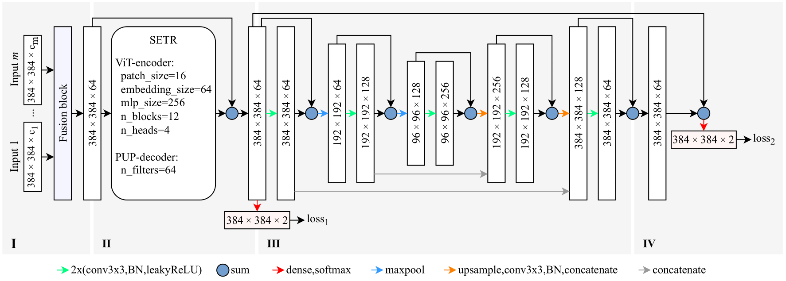

# Scalable Glacier Mapping with Deep Learning

A comprehensive machine learning framework for automated glacier detection and mapping using satellite imagery. This project implements state-of-the-art deep learning models with advanced features including confidence calibration, bias optimization, and test-time augmentation for robust glacier boundary detection.



## 🌟 Key Features

- **Multi-Modal Input Support**: Optical imagery (6 bands), Digital Elevation Models (DEM), SAR data, and thermal imagery
- **Advanced Architectures**: GlaViTU (Vision Transformer-based) and DeepLabV3+ models
- **Uncertainty Quantification**: Confidence calibration using Kernel Ridge Regression
- **Bias Mitigation**: Region-specific bias optimization techniques
- **Test-Time Augmentation**: 8-fold TTA for improved robustness
- **Production Ready**: Scalable deployment pipeline with GPU optimization
- **Flexible Configuration**: Plugin-based system for models, losses, and data processing

## 🏗️ Architecture Overview

### Core Models

#### GlaViTU (Glacier Vision Transformer U-Net)
- **SETR Encoder**: Segmentation Transformer for global context
- **ResUNet Decoder**: Multi-scale feature fusion
- **Deep Supervision**: Multi-level loss computation
- **Location Encoding**: Optional region/coordinate awareness

#### DeepLabV3+
- **ResNeSt Backbone**: Advanced residual network
- **ASPP Module**: Atrous Spatial Pyramid Pooling
- **Encoder-Decoder**: Skip connections for fine details

### Data Processing Pipeline

```
Raw Satellite Data → Feature Compilation → Normalization → 
Patch Extraction → Data Augmentation → Model Training/Inference
```

## 📁 Project Structure

```
├── configs/                    # Configuration management
│   ├── config.py              # Main configuration entry point
│   ├── data.py                # Dataset and dataloader settings
│   ├── training.py            # Training parameters and callbacks
│   ├── finetuning.py          # Transfer learning configuration
│   └── models/                # Model-specific configurations
│       ├── glavitu.py         # GlaViTU model settings
│       └── deeplab.py         # DeepLabV3+ model settings
├── models/                     # Model architectures
│   ├── mapping/               # Segmentation models
│   │   ├── glavitu.py         # GlaViTU implementation
│   │   └── deeplab.py         # DeepLabV3+ implementation
│   └── misc/                  # Utility models and backbones
├── dataloaders/               # Data loading and processing
│   ├── dataloaders.py         # Core dataloader implementations
│   ├── filters/               # Data filtering utilities
│   ├── samplers/              # Sampling strategies
│   ├── transformations/       # Data augmentation
│   └── plugins/               # Extensible data processing plugins
├── layers/                    # Custom neural network layers
│   ├── general/               # General-purpose layers
│   └── transformers/          # Transformer-specific layers
├── losses/                    # Loss function implementations
│   └── losses.py              # Focal, Dice, Tversky, and Weighted losses
├── metrics/                   # Evaluation metrics
│   └── metrics.py             # IoU, Precision, Recall, F1 metrics
├── utils/                     # Utility functions
│   └── utils.py               # Configuration, model building, CLI parsing
├── tta/                       # Test-time augmentation
│   └── tta.py                 # TTA transformations and composition
├── confidence_calibration_models/  # Pre-trained calibration models
├── envs/                      # Environment configurations
│   └── env.yml                # Conda environment specification
├── train.py                   # Main training script
├── evaluate.py                # Model evaluation pipeline
├── predict.py                 # Inference script
├── deploy.py                  # Production deployment
├── finetune.py                # Transfer learning script
├── compile_features.py        # Feature preprocessing
├── glacier_detection_training_gpu.py  # GPU-optimized training demo
├── bias_optimisation.ipynb    # Bias optimization notebook
├── confidence_calibration.ipynb  # Confidence calibration notebook
├── demo.ipynb                 # Project demonstration
└── glacier_detection_training.ipynb  # Training tutorial
```

## 🚀 Quick Start

### 1. Environment Setup

```bash
# Create conda environment
conda env create -f envs/env.yml
conda activate massive-tf

# Verify GPU setup (optional but recommended)
python -c "import tensorflow as tf; print('GPU Available:', tf.config.list_physical_devices('GPU'))"
```

### 2. Data Preparation

Download the glacier dataset:
- **Demo dataset**: [https://bit.ly/49aVPIJ](https://bit.ly/49aVPIJ)
- **Full dataset**: [https://bit.ly/3UgEDgA](https://bit.ly/3UgEDgA)

```bash
# Compile features from raw satellite data
python compile_features.py --optical path/to/optical.tif --dem path/to/dem.tif --output features.pickle
```

### 3. Training

```bash
# Train GlaViTU model with region encoding
python train.py -m glavitu -n my_glacier_model --region_encoding -f optical dem

# Train DeepLabV3+ model
python train.py -m deeplab -n deeplab_model -f optical dem
```

### 4. Evaluation

```bash
# Evaluate trained model
python evaluate.py -m my_glacier_model

# Generate predictions with uncertainty quantification
python predict.py --val --n 5  # 5 MC dropout runs
```

### 5. Deployment

```bash
# Deploy with test-time augmentation and confidence calibration
python deploy.py input_features.pickle -o output_directory/ --tta --smoothing 3
```

## 🔧 Configuration

### Model Configuration

Edit `configs/models/glavitu.py` or `configs/models/deeplab.py`:

```python
# GlaViTU configuration
model_name = "GlaViTU"
dropout = 0.10
use_deepsupervision = True
model_args = {
    "last_activation": "softmax",
    "dropout": dropout,
    "use_deepsupervision": use_deepsupervision,
}
```

### Data Configuration

Edit `configs/data.py`:

```python
# Dataset paths
train_dataset_path = "output/train_dataset.h5"
val_dataset_path = "output/val_dataset.h5"

# Input features and shapes
features = ["optical", "dem"]
input_shapes = {
    "optical": (384, 384, 6),  # 6-band optical imagery
    "dem": (384, 384, 2)       # Elevation + slope
}

# Training parameters
batch_size = 8
patch_size = 384
```

### Training Configuration

Edit `configs/training.py`:

```python
# Learning rate and optimization
lr_start = 5e-4
restart_epochs = [10, 30, 70, 150]
optimizer = tf.keras.optimizers.Adam()

# Loss function (Focal + Dice combination)
loss = losses.WeightedLoss([
    losses.FocalLoss(gamma=2.0),
    losses.DiceLoss(class_idx=1)
], weights=[0.5, 0.5])
```

## 📊 Advanced Features

### Confidence Calibration

Quantify prediction uncertainty using calibrated confidence scores:

```python
# Load pre-trained calibration model
with open('confidence_calibration_models/confidence_calibration_model_glavitu_global_softmax.pickle', 'rb') as f:
    calibration_model = pickle.load(f)

# Apply calibration to predictions
calibrated_confidence = calibration_model.predict(entropy_scores)
```

### Bias Optimization

Optimize region-specific biases to improve model performance:

```python
# Run bias optimization for specific regions
python train.py -m glavitu --region_encoding -r region1 region2 --bias_optimization
```

### Test-Time Augmentation

Improve prediction robustness with 8-fold TTA:

```python
from tta import tta

# Define TTA transformations
tta_transforms = [
    tta.TTAIdentity(),
    tta.TTARot90(), tta.TTARot180(), tta.TTARot270(),
    tta.TTAFlipHorizontally(), tta.TTAFlipVertically(),
    tta.TTACompose([tta.TTARot90(), tta.TTAFlipHorizontally()]),
    tta.TTACompose([tta.TTARot270(), tta.TTAFlipVertically()])
]
```

## 📈 Performance Metrics

The framework provides comprehensive evaluation metrics:

- **IoU (Intersection over Union)**: Primary segmentation metric
- **Dice Coefficient**: Overlap-based similarity measure
- **Precision/Recall**: Classification performance
- **F1 Score**: Harmonic mean of precision and recall
- **Confidence Calibration**: Reliability of uncertainty estimates

### Regional Evaluation

Evaluate performance across different geographical regions:

```bash
python evaluate.py -m my_model -r alps himalayas andes
```

## 🔬 Research Features

### Multi-Modal Fusion

The framework supports various satellite data modalities:

- **Optical**: RGB + NIR bands for visual features
- **DEM**: Elevation and slope for topographic context
- **SAR**: Co-polarized and cross-polarized radar
- **InSAR**: Interferometric coherence
- **Thermal**: Temperature-based features

### Location Encoding

Incorporate geographical context:

```python
# Region encoding: Learn region-specific representations
python train.py --region_encoding

# Coordinate encoding: Use lat/lon coordinates
python train.py --coordinate_encoding
```

### Data Augmentation

Comprehensive augmentation pipeline:

- **Geometric**: Rotation, flipping, scaling, cropping
- **Photometric**: Contrast adjustment, gamma correction
- **Noise**: Gaussian noise injection
- **Occlusion**: Feature masking for robustness

## 🛠️ Development

### Adding Custom Models

1. Implement model in `models/mapping/your_model.py`
2. Create configuration in `configs/models/your_model.py`
3. Register in the configuration system

### Custom Loss Functions

Extend the loss module in `losses/losses.py`:

```python
class CustomLoss(tf.keras.losses.Loss):
    def __init__(self, **kwargs):
        super(CustomLoss, self).__init__(**kwargs)
    
    def call(self, y_true, y_pred):
        # Implement your loss logic
        return loss_value
```

### Data Processing Plugins

Create custom data processing plugins in `dataloaders/plugins/`:

```python
class CustomPlugin:
    def __call__(self, batch):
        # Process batch data
        return processed_batch
```

## 📚 Notebooks and Examples

- **`demo.ipynb`**: Complete project walkthrough
- **`glacier_detection_training.ipynb`**: Training tutorial
- **`confidence_calibration.ipynb`**: Uncertainty quantification
- **`bias_optimisation.ipynb`**: Bias mitigation techniques
- **`glacier_detection_training_gpu.py`**: GPU-optimized training example

## 🔧 Dependencies

### Core Requirements

- **TensorFlow-GPU**: Deep learning framework
- **scikit-learn**: Machine learning utilities
- **rasterio**: Geospatial raster processing
- **h5py**: HDF5 data format support
- **OpenCV**: Computer vision operations
- **matplotlib**: Visualization
- **pandas**: Data manipulation
- **geopandas**: Geospatial data processing

### Optional Dependencies

- **CUDA/cuDNN**: GPU acceleration
- **rioxarray**: Xarray-based raster operations
- **matplotlib-scalebar**: Map scale bars
- **umap-learn**: Dimensionality reduction
- **holoviews**: Interactive visualization

## 📄 License

This project is licensed under the GNU General Public License v2.0. See the [LICENSE](LICENSE) file for details.

## 🤝 Contributing

1. Fork the repository
2. Create a feature branch (`git checkout -b feature/amazing-feature`)
3. Commit your changes (`git commit -m 'Add amazing feature'`)
4. Push to the branch (`git push origin feature/amazing-feature`)
5. Open a Pull Request

## 🔧 Troubleshooting

### Common Issues

#### NumPy/SciPy Version Conflicts

If you encounter `ModuleNotFoundError: No module named 'numpy.exceptions'`, this indicates a version compatibility issue:

```bash
# Fix by installing compatible versions
pip install "numpy<=1.24.3,>=1.22" "scipy<1.11"

# Verify the fix
python -c "from sklearn.metrics import confusion_matrix; print('✓ Dependencies fixed')"
```

#### GPU Setup Issues

```bash
# Check GPU availability
python -c "import tensorflow as tf; print('GPU Available:', tf.config.list_physical_devices('GPU'))"

# If no GPU detected, ensure CUDA and cuDNN are installed
# For TensorFlow 2.13.1, use CUDA 11.8 and cuDNN 8.6
```

#### Memory Issues

```bash
# Enable memory growth for GPU
export TF_FORCE_GPU_ALLOW_GROWTH=true

# Or reduce batch size in configs/data.py
batch_size = 4  # Instead of 8
```

## 📞 Support

For questions and support:

1. Check the [demo notebook](demo.ipynb) for usage examples
2. Review the [training tutorial](glacier_detection_training.ipynb)
3. Examine configuration files in the `configs/` directory
4. See troubleshooting section above for common issues
5. Open an issue for bug reports or feature requests

## 🏔️ Citation

If you use this framework in your research, please cite:

```bibtex
@software{glacier_detection_framework,
  title={Scalable Glacier Mapping with Deep Learning},
  author={[Author Names]},
  year={2024},
  url={https://github.com/[username]/glacier-detection}
}
```

## 🌍 Applications

This framework has been successfully applied to:

- **Glacier Inventory Mapping**: Automated glacier boundary detection
- **Climate Change Monitoring**: Temporal glacier change analysis
- **Hazard Assessment**: Glacial lake outburst flood risk evaluation
- **Water Resource Management**: Glacier contribution to water supply
- **Scientific Research**: Large-scale glaciological studies

---

**Built with ❄️ for glacier research and climate science**